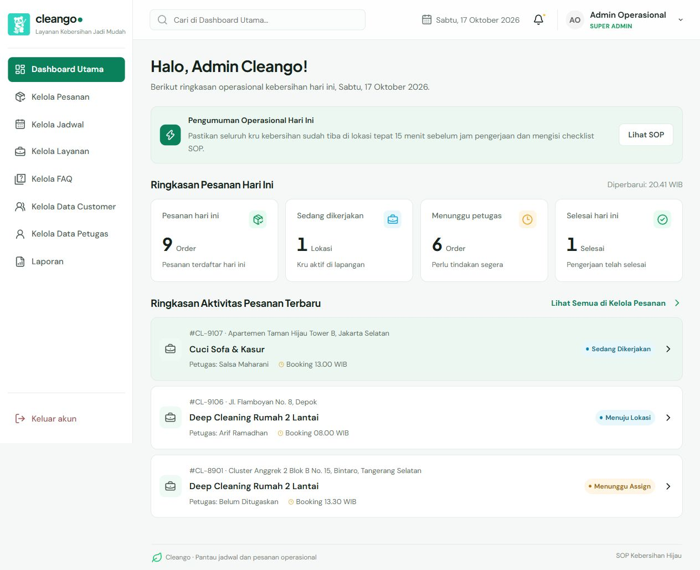

# Perbandingan screenshot Figma dan frontend

Acuan Figma adalah PNG yang sudah disimpan pada audit 16 Oktober, bukan pembacaan ulang file Figma langsung. Screenshot frontend diambil ulang pada checklist 17 Oktober. Perubahan yang sudah diminta pengguna menjadi acuan perilaku terbaru; perbandingan ini tidak mengklaim pixel-perfect.

| Halaman | Acuan tersimpan | Web terbaru | Penilaian |
| --- | --- | --- | --- |
| Login | [Figma](../figma-comparison-2026-10-16/figma-login.png) | [1280](screenshots/login-1280.jpg), [360](screenshots/login-360.jpg) | Form dan identitas utama tersedia; logo panda mengikuti revisi pengguna. |
| Dashboard | [Figma](../figma-comparison-2026-10-16/figma-dashboard.png) | [1280](screenshots/dashboard-1280.jpg), [768](screenshots/dashboard-768.jpg), [360](screenshots/dashboard-360.jpg) | Sidebar, empat ringkasan, pengumuman, dan aktivitas tersedia. Nilai mengikuti data demo; aksen/kerapatan berbeda. |
| Pesanan | [Figma](../figma-comparison-2026-10-16/figma-pesanan.png) | [1280](screenshots/pesanan-1280.jpg), [detail HP](screenshots/pesanan-detail-360.jpg) | Urutan aktivitas, status perjalanan, rekomendasi keahlian dan detail terpisah mengikuti revisi terbaru. Jarak/ETA nyata belum tersedia. |
| Jadwal | [Figma](../figma-comparison-2026-10-16/figma-jadwal.png) | [1280](screenshots/jadwal-1280.jpg), [detail HP](screenshots/jadwal-detail-360.jpg) | Sengaja khusus shift petugas terdaftar. Nama customer, area operasional, dan daftar pesanan terhubung dihilangkan sesuai permintaan. |
| Layanan | [Figma](../figma-comparison-2026-10-16/figma-layanan.png) | [1280](screenshots/layanan-1280.jpg), [form HP](screenshots/layanan-form-360.jpg) | Foto, fasilitas, publikasi dan harga normal tersedia. Diskon dipusatkan di Kelola Promo; banner berada pada pengelola promo. |
| FAQ | [Figma](../figma-comparison-2026-10-16/figma-faq.png) | [1280](screenshots/faq-1280.jpg), [detail HP](screenshots/faq-detail-360.jpg) | Jawaban langsung terlihat; tindakan sejajar pada desktop dan menyesuaikan HP. Pagination diuji. |
| Customer | [Figma](../figma-comparison-2026-10-16/figma-customer.png) | [1280](screenshots/customer-1280.jpg), [detail HP](screenshots/customer-detail-360.jpg) | Pendaftaran dan catatan customer dihilangkan sesuai revisi. Statistik/favorit/kru berasal dari pesanan selesai. |
| Petugas | [Figma](../figma-comparison-2026-10-16/figma-petugas.png) | [hasil akhir](screenshots/filter-petugas-final-1280.jpg), [360](screenshots/petugas-360.jpg) | Profil dan status operasional memakai tahap individu. Filter Nonaktif dan Bertugas telah diperbaiki. |
| Laporan | [Figma](../figma-comparison-2026-10-16/figma-laporan.png) | [1280](screenshots/laporan-1280.jpg), [rincian HP](screenshots/laporan-rincian-360.jpg) | Empat tab, ringkasan, rincian transaksi, dan CSV tersedia. Bukan bukti pembayaran nyata. |

Portal cleaner merupakan tambahan alur operasional: [siap berangkat](screenshots/cleaner-siap-360.jpg), [pengerjaan](screenshots/cleaner-bekerja-360.jpg), dan [selesai](screenshots/cleaner-selesai-360.jpg). Pengujian dilakukan pada viewport 360 px.

## Contoh perbandingan dashboard

| Figma tersimpan | Implementasi yang diuji |
| --- | --- |
|  |  |

Perbedaan data, logo, warna, jumlah kartu, serta konten shift tidak disamakan secara paksa dengan desain lama. Sinkronisasi backend/mobile, GPS, dan pengiriman WhatsApp tetap menunggu API tim.
