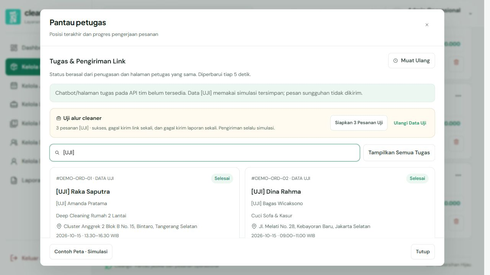
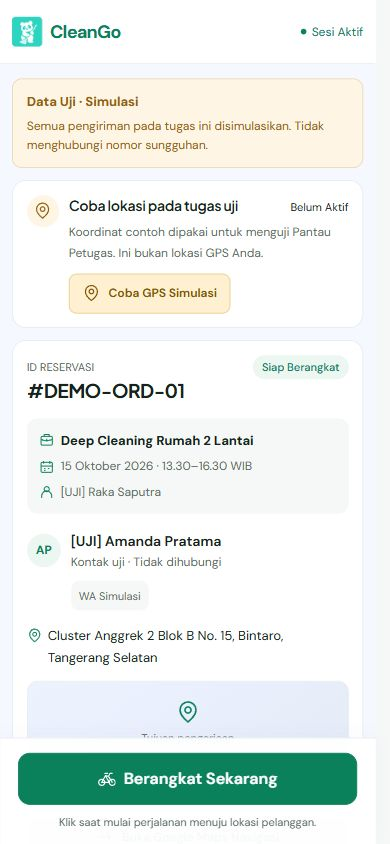
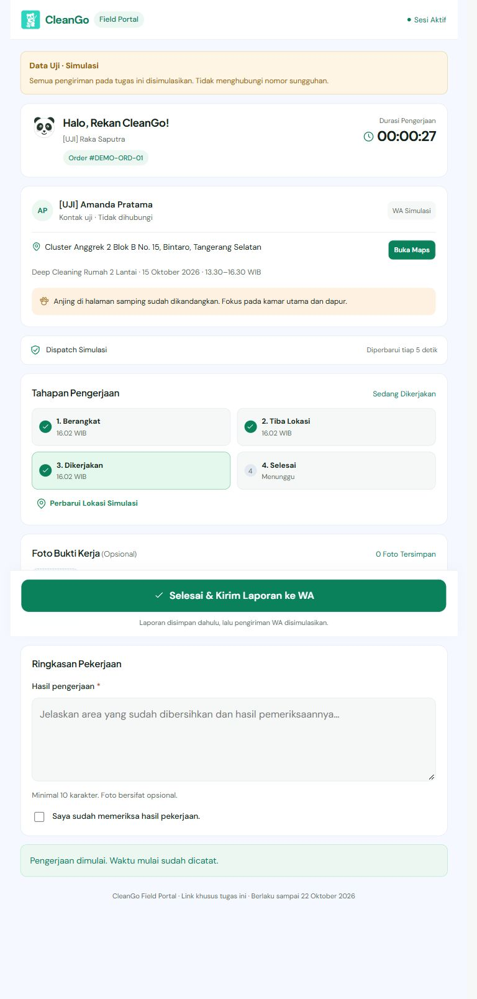
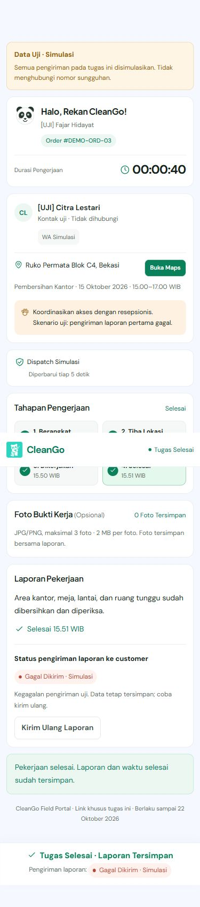

# Pemeriksaan alur cleaner — 15 Oktober 2026

Implementasi mencakup Pantau Petugas, popup pratinjau, halaman publik `/tugas/:token`, dispatch setelah penugasan, foto/laporan, status pengiriman terpisah, dan tiga skenario data uji. Komponen popup, font, warna, dan ikon mengikuti komponen proyek. Halaman cleaner menggunakan dua referensi screenshot pengguna; ini bukan klaim pencocokan layer Figma secara pixel-perfect.

## Hasil

- `npm run build`, `npm run typecheck`, dan `npm run format:check` lolos. Data `.local` tidak ikut tracing build.
- Pemeriksaan 26 manifest server memastikan data/kunci lokal tidak ikut paket build; tiga pesanan uji kembali Menunggu Assign, link lama dicabut, dan server preview memberi HTTP 200. Hasil: [readiness-checks.json](readiness-checks.json).
- 10 kelompok pemeriksaan HTTP melalui server Next yang berjalan: autentikasi admin, asal permintaan, seed berulang, cakupan/tampering token, foto lintas tugas, urutan tindakan, keberangkatan/kedatangan bersamaan, validasi foto/laporan, penyelesaian idempotent, dan kesamaan status admin. Hasil: [api-checks.json](api-checks.json).
- 11 kelompok pemeriksaan penyimpanan terisolasi: persistensi sesudah module server dimuat ulang, kedaluwarsa, pencabutan link setelah ganti petugas/batal/reset, recovery pengiriman terputus, recovery file lock, penyelesaian beberapa kru, serta penonaktifan demo. Hasil: [store-checks.json](store-checks.json).
- 8 kelompok pemeriksaan adapter dengan transport dalam memori: hanya Bearer tugas yang diteruskan, allowlist data publik, draf laporan selalu ke customer, konfirmasi provider wajib untuk Terkirim, simulasi tanpa draf nomor nyata, masa berlaku/timestamp, idempotensi, foto, dan endpoint dispatch belum tersedia. Hasil: [adapter-checks.json](adapter-checks.json).

## Pemeriksaan browser

Pengulangan menemukan benturan pemulihan lock di Windows ketika dua permintaan datang bersamaan. Antrean transaksi per proses sekarang dipertahankan lintas development reload sebelum mengambil lock disk. Sesudah perbaikan, skenario recovery dan 40 penulisan bersamaan diulang sepuluh kali tanpa kegagalan. Mode JSON ini tetap dibatasi satu proses frontend/disk lokal; produksi memakai database backend.

Regresi menu lama juga diperiksa: keenam popup detail, Kelola Promo, SOP, dashboard, halaman laporan, dan unduh CSV tetap berfungsi. Tidak ada error console pada tab pengujian ini. Hasil: [regression-checks.json](regression-checks.json).

Penugasan tiga pesanan diuji melalui popup Tugaskan Petugas yang sudah ada. Pesanan 01 berhasil melewati pratinjau iframe, berangkat, tiba/mulai bekerja, unggah foto, refresh, validasi laporan kosong, dan penyelesaian. Waktu mulai dan foto tetap tersimpan setelah refresh. Status di Kelola Pesanan berubah menjadi Selesai.

Pesanan 02 menyimpan penugasan walaupun pengiriman link pertama gagal. Halaman tugas tetap dapat dibuka dan tombol Kirim Ulang ke Petugas menghasilkan Simulasi Berhasil. Pesanan 03 selesai dengan laporan tersimpan walaupun pengiriman laporan pertama gagal. Refresh tetap menunjukkan pekerjaan selesai dan opsi Kirim Ulang Laporan; retry berhasil tanpa mengubah laporan/waktu selesai.

Pratinjau tetap berada di satu dialog pada halaman Pesanan; URL admin tidak berpindah. Tombol kembali dan tutup bekerja. Halaman langsung membuka pesanan/petugas yang sama tanpa shell admin. Reset melalui UI mencabut link lama; refresh pada link tersebut menampilkan penjelasan link tidak tersedia. Seed/reset dipisahkan agar seed berulang tidak menghapus progres.

Responsif diperiksa pada lebar 360, 390, 768, dan 1280 piksel. Halaman cleaner tidak memiliki overflow horizontal; footer utama tetap di dalam viewport. Isi iframe dapat digulir sendiri, sementara toolbar/tutup tetap tersedia. Console browser tidak menunjukkan error React pada pengujian akhir. GPS yang dicoba memakai koordinat simulasi yang diberi label, bukan lokasi perangkat.

Tombol Salin Link menampilkan hasil berhasil dan kolom link tetap dapat dipilih/disalin manual. Sinkronisasi clipboard browser uji dengan clipboard desktop tidak dapat diverifikasi melalui browser tertanam; pemeriksaan tempel di Brave/HP tetap diperlukan. Belum dilakukan pengujian pada HP fisik, izin GPS sungguhan, provider WhatsApp, database tim, atau mobile Flutter. Tidak ada pesan sungguhan yang dikirim selama pengujian.

## Mengulang pemeriksaan

Untuk mencoba sebagai pengguna, ikuti [README frontend](../../README.md#mencoba-alur-cleaner). Tiga pesanan dikembalikan ke **Menunggu Assign** setelah pemeriksaan. Data uji tidak berasal dari atau ditulis ke backend tim.

Pemeriksaan penyimpanan/adapter memakai direktori sementara dan transport lokal tanpa mengubah data aplikasi:

```sh
node docs/cleaner-workflow-2026-10-15/store-check.mjs
node docs/cleaner-workflow-2026-10-15/adapter-check.mjs
```

`verify.mjs` adalah smoke test HTTP yang mengubah progres DEMO-ORD-02. Mulai dari reset, tugaskan 01 ke Raka, 02 ke Dina, 03 ke Fajar; jalankan 01 sampai bekerja dan unggah satu foto. Isi `TEST_ADMIN_COOKIE` dengan sesi preview admin dan opsional `TEST_APP_URL`, lalu jalankan script. Script menolak memproses pesanan biasa dan tidak menyimpan token/cookie/link dalam hasil JSON. Ulangi Data Uji sesudahnya.

## Bukti tampilan





